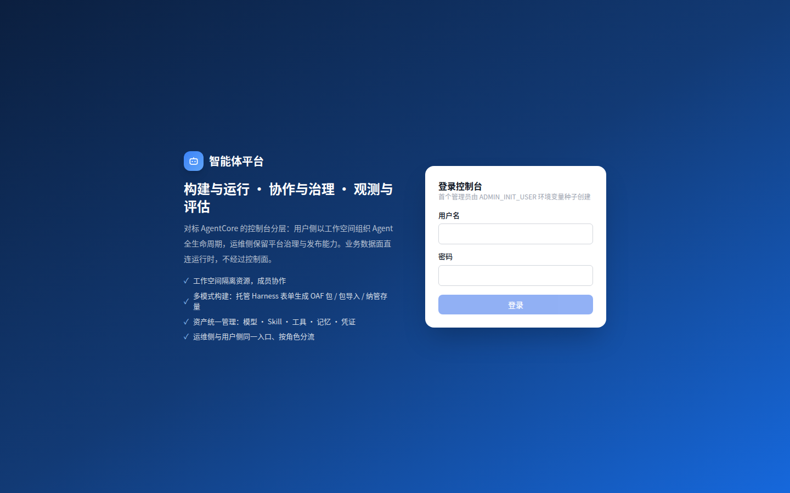
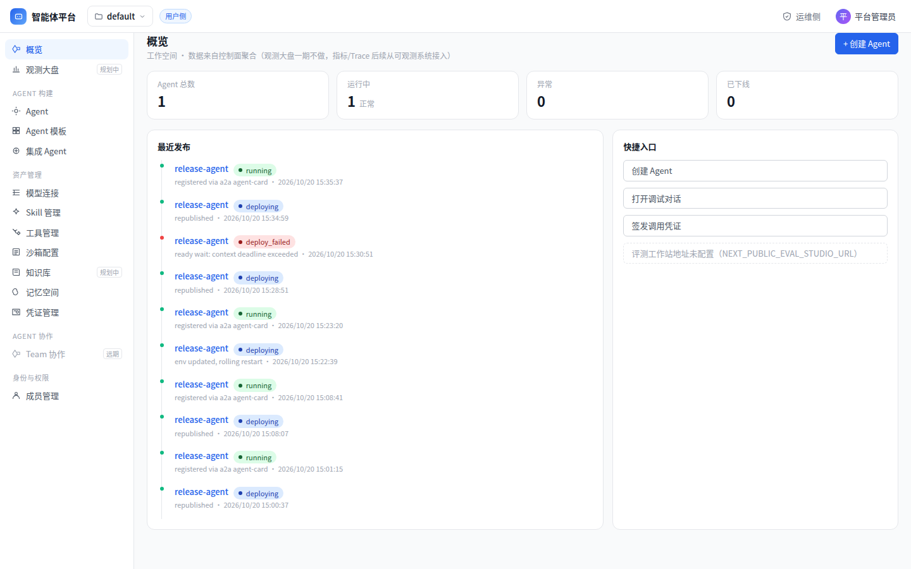
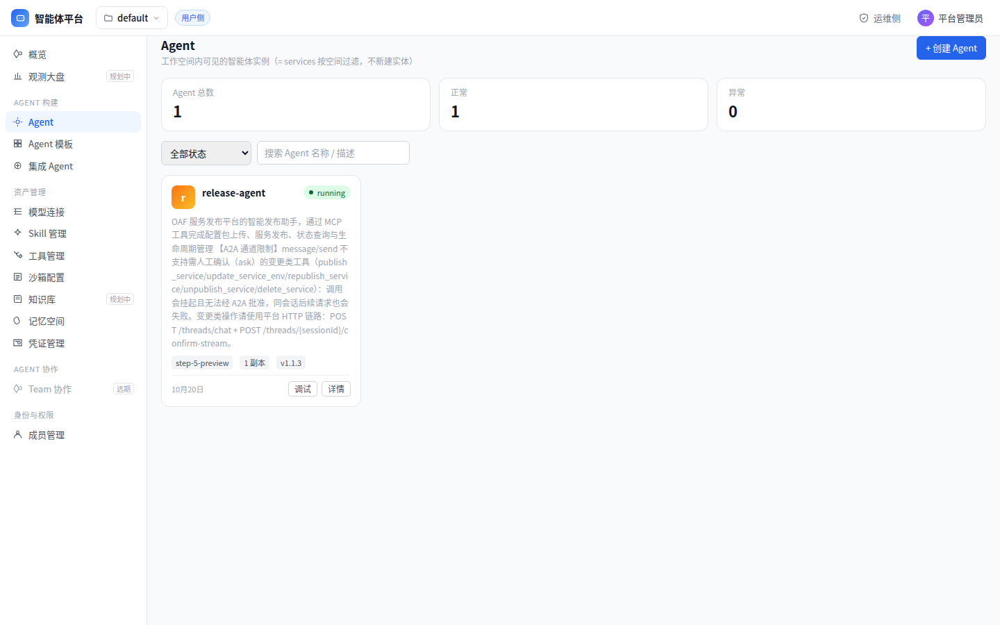
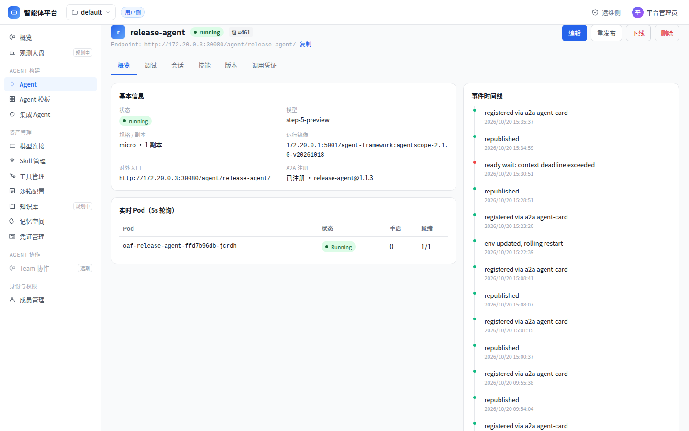
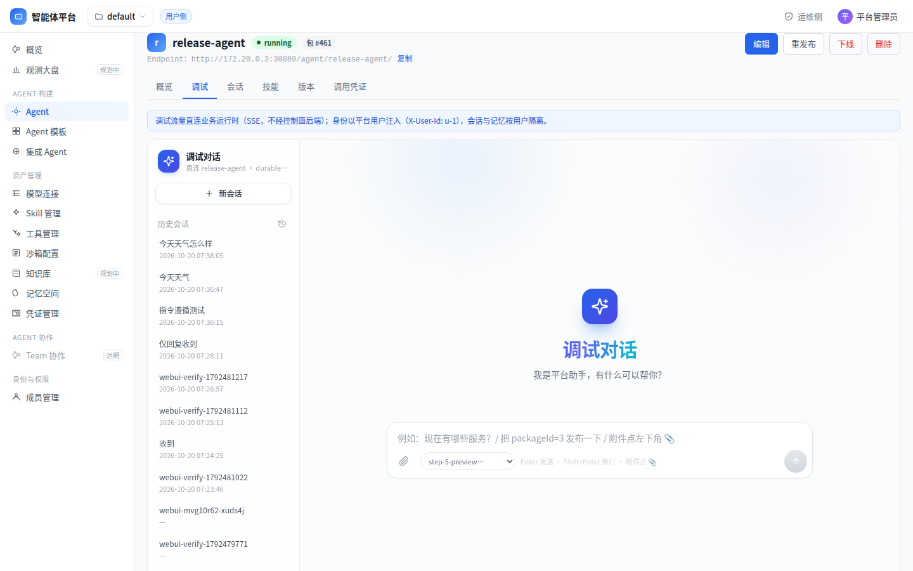
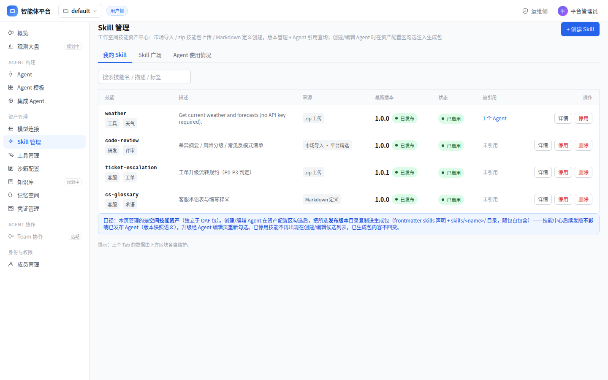
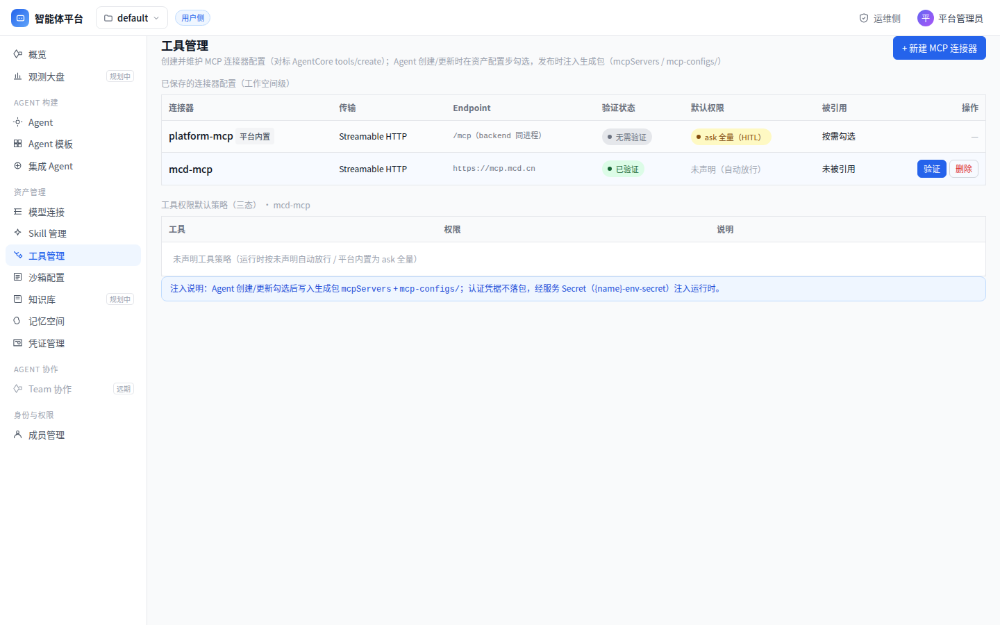
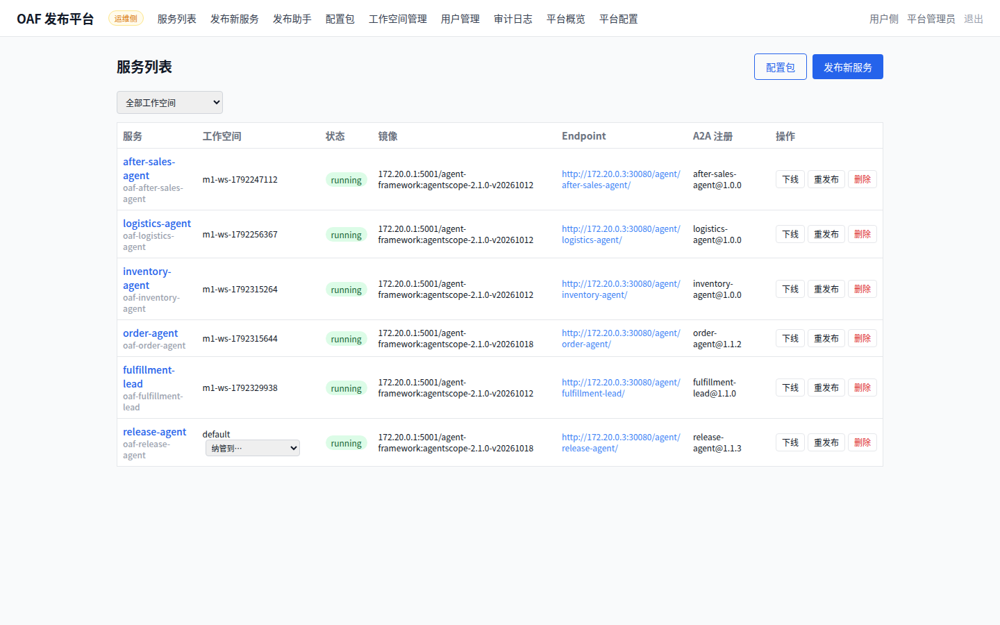

# OAF 服务发布平台（Agent Manager v2）

上传符合规范的 **OAF 配置包** → K8s 原生 Deployment/Service/Ingress 拉起服务 → 就绪后自动经 A2A `/.well-known/agent-card.json` 注册 → 列表/状态/重新发布/下线全生命周期管理。核心能力同时以 **MCP 服务**暴露，并由基于 agent-framework 的 **智能发布助手 release-agent**（对话式操作）自举运行于集群内。

控制台（2026-10 拆分）：JWT 登录，**用户侧**以工作空间组织 Agent 全生命周期（多模式构建 / 资产中心 / 成员协作），**运维侧**保留平台治理与发布能力（服务/工作空间/用户/审计）；业务数据面（env / 包 / 流量）直连集群，不经过控制面。

> 历史设计文档归档：[docs/design/](docs/design/)（v1→v2 重构决策与实施记录见 [REDESIGN.md](docs/design/REDESIGN.md)）
> 历史版本：git tag `v1-archive`

## 架构

```
              浏览器 :8911（宿主机 nginx 统一入口）
                /                      \
         控制台 UI                  /api/*、/mcp
    platform-frontend           platform-backend (Go)
    (Next.js, :30881)         REST /api/v1 + MCP /mcp 同进程
    用户侧 /console                JWT 鉴权（/auth /console /admin）
    运维侧 /admin                      │ client-go
        ┌─────────────────────────────┼──────────────────────────┐
        ▼                             ▼                          ▼
  Deployment oaf-*             Service oaf-*-svc           Ingress oaf-*
  包: PVC subPath → /config    ClusterIP :8100       router 模式 /agent/{short}
  env: ConfigMap/Secret envFrom                     （platform-router 剥前缀，
        │                                            发布链路零写入）
        ▼
  业务 Pod（agent-framework 等兼容镜像，AGENT_CONFIG_DIR=/config）
        └── 就绪后由平台拉取 /.well-known/agent-card.json 注册入库

  release-agent：平台自举发布的第一个服务，经 MCP 驱动整个发布流程
```

**控制面/业务面分层**（强约束）：backend 是控制面，重启/升级不影响已发布业务——业务 K8s 资源只由显式发布 API 写入，业务运行时不依赖 backend 可用性（env 经 CM/Secret envFrom 常驻、包经 PVC 只读直挂、流量经 Ingress 直连）。agent-framework 是业务面，影响正确性的状态只落共享存储（MySQL checkpoint / Redis），Pod 无状态可横向扩展。

## 技术栈

| 层 | 选型 |
|----|------|
| 管理后端 | Go 1.26 + Gin + GORM + client-go（REST `/api/v1` 与 MCP streamableHttp `/mcp` 同进程） |
| MCP SDK | modelcontextprotocol/go-sdk v1.3.1 |
| 前端 | Next.js 16 + React 19 + Tailwind（控制台：用户侧工作空间 + 运维侧治理 + 登录） |
| 业务运行时 | agent-framework（Java/Spring Boot :8100，AgentScope Harness 2.x） |
| 元数据库 | 集群内 MySQL 8.0（`oaf_platform` / `oaf_checkpoint` 两库） |
| 存储 | 共享 PVC `platform-data`（包只读挂 /config + 可写工作区 /workspace） |
| 会话事件流 | Redis Streams（durable SSE，多副本续传） |
| 集群 | Kind 单节点 + ingress-nginx + platform-router（子路径路由） |

## 入口

| 入口 | 地址 |
|------|------|
| 控制台统一入口 | http://100.66.1.5:8911（未登录 307 → `/login`） |
| 发布助手对话页 | http://100.66.1.5:8911/assistant |
| REST API | http://localhost:30080/api/v1 |
| MCP | http://localhost:30080/mcp |
| 业务 Agent（router 模式） | http://172.20.0.3:30080/agent/{name}/ |

首个管理员由 backend 环境变量 `ADMIN_INIT_USER` / `ADMIN_INIT_PASSWORD` 种子创建（仅 users 空表时生效）；`JWT_SECRET` 必填，缺失启动 fail-fast。

## 快速开始

```bash
# 构建 + 导入镜像 + 部署全流程
see docs/deployment.md
```

开发态：

```bash
cd backend && make test          # go vet + 单测
cd backend && make run-dev       # 宿主机直跑后端（KUBECONFIG 回退）
cd frontend && npm run dev       # 前端热更
```

## 项目结构

```
agent-manager/
├── backend/            # Go 管理后端（REST+MCP+K8s+DB，控制面）
├── frontend/           # Next.js 控制台（登录 / 用户侧工作空间 / 运维侧治理 / 发布助手对话）
├── agent-framework/    # 业务 Agent 运行时（Java，A2A/单次流/Debug Console）
├── release-agent/      # 智能发布助手的 OAF 包（mcp-configs → 平台 MCP）
├── manifests/          # 平台自举清单（ns/PVC/RBAC/MySQL/backend/frontend/router/ingress）
├── charts/             # oaf-platform Helm Chart（离线部署）
├── e2e/                # 回归脚本（console-split 按功能套件 + 存量 A~E 场景）
├── demo/               # order-fulfillment 多 Agent 协同演示（Agent Protocol 远程子 agent）
└── docs/               # 部署指南 + OAF 规范 + 设计归档（docs/design/）+ 实施记录（docs/implementation/）
```

## 界面展示

### 登录（JWT 会话；首个 admin 由 `ADMIN_INIT_USER` 种子创建）



### 工作台概览（工作空间统计卡 + 最近发布时间线 + 快捷入口）



### Agent 列表（工作空间内智能体实例：状态筛选 / 模型·副本·版本 / 调试·详情入口）



### Agent 详情 · 概览（基本信息 / 实时 Pod（5s 轮询）/ 事件时间线；另有调试·会话·技能·版本·调用凭证 Tab）



### Agent 详情 · 调试（ChatPane SSE 直连业务运行时，不经控制面；会话按用户隔离）



### 资产 · Skill 管理（市场导入 / zip 技能包上传 / Markdown 定义创建，版本管理 + Agent 引用查询）



### 资产 · 工具管理（MCP 连接器 + 三态工具权限策略，发布时经 mcp-configs 注入生成包）



### 运维侧 · 服务列表（全平台服务 / Endpoint / A2A 注册状态 / 生命周期操作）



> 截图为 kind 集群真实运行界面（1440×900 实拍）。控制台拆分全量页面画廊（26 张，含创建表单/模型连接/记忆/凭证/成员/审计等）见 [docs/screenshots/console-split/README.md](docs/screenshots/console-split/README.md)。

## 测试与回归

```bash
# 单测
cd backend && make test                        # go vet + go test
cd frontend && npm run lint && npm run build   # 前端 lint + 构建
cd agent-framework && mvn test                 # 业务运行时单测

# E2E（需本地 kind 集群且平台已部署）
cd e2e/console-split && ./run-all.sh           # 控制台九模块（auth/治理/构建/详情/模型/工具/集成/空间资产）
cd e2e && ./platform-e2e.sh                    # A/B：REST 主链路 + 动作矩阵
cd e2e/mcpclient && go run . -zip ../fixtures/demo-agent-v1.zip   # C：MCP 全链路
cd e2e && node ui-e2e.js                       # D：UI 流程
cd e2e && ./agent-e2e.sh                       # E：发布助手自然语言驱动
```

CI（GitHub Actions）按改动目录过滤触发三个工作流（backend / frontend / agent-framework），master 分支强制 PR 门禁，详见 `.github/workflows/`。

## 注意事项

- OAF 包要求：根级 `AGENTS.md`（frontmatter 必填校验为宽松模式，引用缺失仅 warnings）
- 平台保留键（用户 env 不可覆盖）：`AGENT_CONFIG_DIR`、`AGENT_WORKSPACE_DIR`、`SERVER_HOST`、`SERVER_PORT`；env 为全量覆盖语义（上限 64 键 × 32KB），敏感键自动路由进服务 Secret
- MCP server 不可达默认不阻断业务启动；必需依赖在包内声明 `startup.required: true`
- 技能（Skill）与工具（MCP 连接器）为工作空间级资产：创建/编辑 Agent 时勾选注入生成包（版本快照语义，资产后续发版不影响已发布 Agent）
- 发布新服务时平台自动派生 per-service checkpoint 库与 Redis 前缀（服务间数据隔离，issue #142）；存量服务 env 已固化，收敛需显式改 env 后 republish
- 敏感配置在 `.env.secrets`（gitignored）；MySQL 凭据见 `manifests/platform.yaml`
