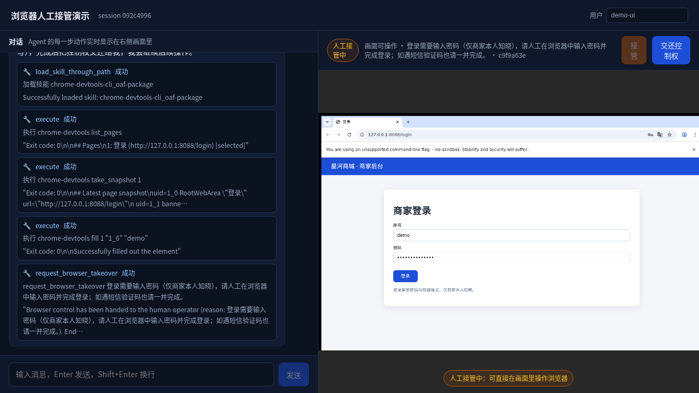
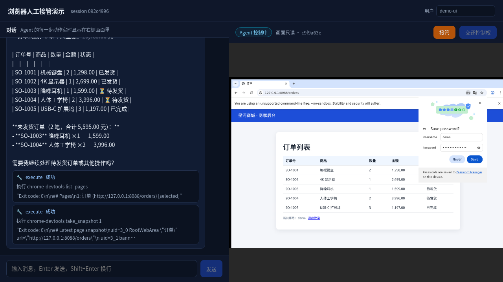

# 浏览器人工接管 Demo · 演示指南

## 一、部署

```bash
cd demo/browser-takeover
SECRETS_FILE=/root/agent-manager/.env.secrets ./deploy.sh        # 首次会构建并导入沙箱镜像
cd frontend && npm install && npm run dev                        # http://<主机IP>:5188
#   若访问链路会重置 WebSocket 升级（表现为「画面连接断开，正在重试」+ DevTools 里
#   ws:// ERR_CONNECTION_RESET、且服务端无请求记录），可改用 HTTPS 入口：
npm run dev:https                                              # https://<主机IP>/（自签证书需点继续）
#   实时画面统一经同源业务代理，不再支持通过 vncBase 参数指定外部网关。
```

`deploy.sh` 做的事：构建/导入沙箱镜像 → （可选）构建 agent-framework 镜像 → 应用 platform-router
清单 → 上传 `packages/browser-agent` → 经平台 API 发布服务 `browser-takeover` → 等 running。

> 实时画面 WS 握手要求 Origin 白名单：`deploy.sh` 缺省给业务服务注入
> `AGENT_BROWSER_ALLOWED_ORIGIN_PATTERNS=http://*:5188,https://*`（对应 vite 代理后的
> 演示前端来源）。换端口/域名时用 `DEMO_ORIGIN_PATTERNS=... ./deploy.sh` 覆盖，禁止配 `*`。

> 工作区在 worktree 时 `.env.secrets` 不在 worktree 根目录，用 `SECRETS_FILE=` 指到主工作区。

## 二、演示剧本 A：Agent 主动请求接管（登录场景）

1. 前端左侧发消息：
   「打开 http://127.0.0.1:8088/ 登录页，用账号 demo 登录，然后把订单汇总给我。」
2. 右侧画面里能看到 Agent 打开登录页、读取表单；它没有密码，于是调用
   `request_browser_takeover`，对话里出现该工具调用，顶栏徽章变为「人工接管中」，画面可操作。
3. 人工在右侧画面里输入密码 `HumanOnly-2026`，点「登录」，页面进入订单列表。
4. 点「交还控制权」：徽章回到「Agent 控制中」，画面变只读；Agent 先
   `chrome-devtools list_pages` + `take_snapshot` 重新采样，确认已登录后汇总订单
   （订单总数 / 总金额 / 未发货列表）。

## 三、演示剧本 B：执行中人工主动接管

1. 发消息让 Agent 做一串慢动作，例如「把订单表格逐行读出来，并截图到 /tmp/orders.png」。
2. Agent 执行过程中点「接管」：当前轮被停止（对话里出现「本轮已被停止」），徽章变「人工接管中」。
3. 接管期间再发一条命令类消息（如「继续把账号填上」）：Agent 的 `execute` 调用会被明确拒绝
   （工具行显示 DENIED）——闸门生效。
4. 点「交还控制权」：Agent 重新采样后继续未完成的任务。

## 四、界面截图（真实运行）

接管中：Agent 已填好账号并请求人工接管，右侧画面可直接操作（人工在画面里输入密码）：



交还后：Agent 重新采样并汇总订单，画面回到只读：



## 五、演示站点

| 项目 | 值 |
|------|-----|
| 地址（沙箱内） | `http://127.0.0.1:8088/` |
| 账号 | `demo` |
| 密码 | `HumanOnly-2026`（仅人工知晓；站点内只存 sha256 摘要） |
| 页面 | `/login` 登录表单 → `/orders` 订单列表（5 条订单，含状态） |

## 六、验证

```bash
node e2e/browser-takeover-e2e.mjs
```

断言覆盖：预热 CLI → 被动触发接管 → 接管期间 `execute` DENIED → 人工用 CLI 完成登录 →
交还后首个命令是重采样 → 汇总订单 → 主动接管停轮 → 二次交还继续。
需要 `127.0.0.1:18600` 的 OpenSandbox 端口转发（`scripts/deploy-opensandbox.sh` 会保持）。

## 七、排障

| 现象 | 处理 |
|------|------|
| 画面一直「沙箱未创建」 | 先发一条消息让 Agent 建沙箱；或 `kubectl -n opensandbox get pods` 看沙箱 Pod |
| 画面连不上（4404/1011） | agent-framework 侧 `getEndpoint(6080)` 无端点或 server 代理不可达；`kubectl -n agent-platform logs deploy/oaf-browser-takeover` |
| 前端 REST 正常但 WS 失败 | platform-router 的 Upgrade 透传未生效：确认已 `kubectl apply -f manifests/platform-router.yaml` 且 router Pod 已滚动重启 |
| 命令超时被 kill | execd `/command` 的 `timeout` 单位是毫秒（框架内 SDK 已按秒换算，脚本手调时注意） |
| 接管后 Agent 仍能执行命令 | 检查 `AGENT_BROWSER_ENABLED=true` 且服务 env 的 `AGENT_REDIS_*` 有效（控制权锁在 Redis，键 `brw:ctrl:{sid}`） |
| 服务发布 409/镜像拒绝 | 服务镜像必须是平台白名单内的 `172.20.0.1:5001/agent-framework:latest` |
| 画面卡在「正在连接实时画面」 | 重启前端 dev server（noVNC 用顶层 await，已配 `optimizeDeps.exclude`；依赖缓存过期会 504） |
| 建箱失败 `KUBERNETES::POD_FAILED`（容器退出码 127） | `SANDBOX_ENTRYPOINT` 未生效：服务 env 需含 `SANDBOX_ENTRYPOINT=/browser-entrypoint.sh`（yml 映射已补） |
| 节点 CPU 打满导致新 Pod Pending | 沙箱按 `SANDBOX_CPU_COUNT` 申请 CPU；同时活着的沙箱数受 `SANDBOX_USER_QUOTA` 限制，清理遗留沙箱见下 |
| 画面一直「正在重试」且服务端无请求记录 | 访问链路上的代理/安全软件重置了 WS 升级：改用 `npm run dev:https` 的 HTTPS 入口（wss 走 TLS），或为浏览器代理加 100.66.1.11 例外，或用同网段 `http://<LAN IP>:5188` |
| 清理遗留沙箱 | `kubectl -n opensandbox get pods` 找到 `<sandboxId>-0`；`DELETE /v1/sandboxes/{id}`（需重建时让对应会话再发一轮消息） |
